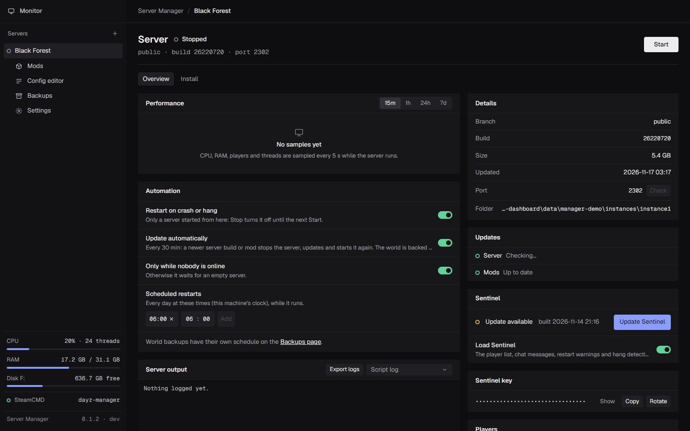
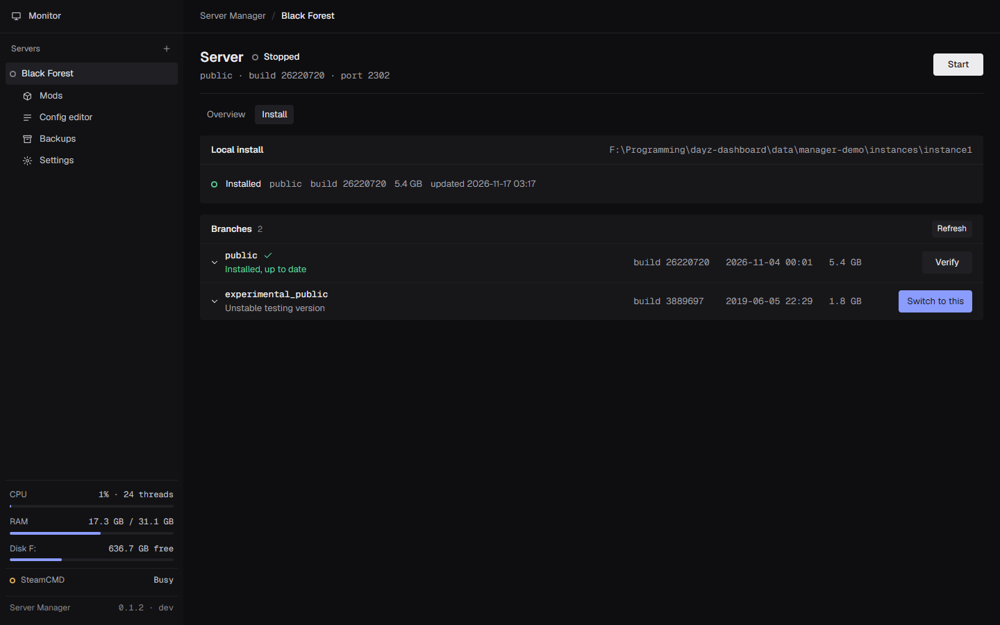

# Server

Click a server's name in the sidebar to open this page. It's where you run the
server and watch it.

The top shows the state (Stopped, Starting, Running, **Not responding**,
Restarting, Installing or Not installed) with the branch, build and port under
it. This is the only place with **Start**, **Stop** and **Restart**.

- **Start** runs the server on a hidden desktop of its own, so no console window
  pops up, and with Windows' crash dialogs turned off. Want to see the window?
  Turn on **Show server window** under **Settings → Launch parameters**.
- **Stop** closes it.
- **Restart** with nobody online restarts right away. With players online it
  asks first, and **Warn and restart in 5 min** tells them in chat at 5 and 1
  minutes (needs [Sentinel](sentinel)).

The page has two tabs, **Overview** and **Install**.

## Overview

### Performance

CPU, RAM, players and threads, sampled every 5 seconds while the server runs and
kept for 7 days. Switch between **15m**, **1h**, **24h** and **7d**.

### Automation

- **Restart on crash or hang** watches the server every 10 seconds and starts it
  again if it:
  - exits or crashes,
  - stops responding for 2 minutes, or
  - shows an error popup (it closes the popup first).

  It only watches a server started from the Manager, and **Stop** turns it off
  until the next **Start**. After 5 restarts in 15 minutes it gives up and says
  so; then start it by hand once you've found the cause.
- **Update automatically** checks every 15 minutes for a newer build of the
  installed branch, and for mod updates. When it finds one it warns players in
  chat (15, 10, 5 and 1 minutes), stops the server, backs up the world, updates,
  and starts it again.
  - **Only while nobody is online** waits for an empty server instead of
    warning.
- **Scheduled restarts** are times of day (this machine's clock) to restart at,
  while the server runs. Pick the hour and minute and press **Add**; the **×**
  removes one. Players are warned at 15, 10, 5 and 1 minutes.

World backups have their own schedule, on the [Backups](backups) page.

### Server output

The end of the newest **Script log** and **Engine log (RPT)**, so you can see
errors without opening files.

**Export logs** saves one file with the newest server logs (script, RPT, error
and crash logs) and the Manager's own logs, ready to send when asking for help.
Passwords, keys and player IPs are left out.

### Details

Branch, build, size, last update, port and folder.

**Check** (next to the port, while running) asks Steam whether it lists your
server. **Listed on Steam** means the server is talking to Steam. It doesn't
prove players can reach it from outside your network: for that, the game and
query ports (2302 and up, UDP) must be forwarded on your router.

### Updates

Whether the **Server** and **Mods** are up to date.

### Sentinel and Sentinel key

Install, update or turn off [Sentinel](sentinel), and see or rotate its key.

### Players

Who's online, live, once Sentinel is connected. The box underneath sends a
message to everyone in chat (up to 256 characters).

### Backups

The newest backups. **All backups** opens the [Backups](backups) page.

## Install

**Local install** shows what's installed: branch, build, size, date and folder.

**Branches** lists every branch Steam has for the DayZ server (`public` is
stable, and the experimental ones), each with its build, date and size. Expand a
branch to see its depots.

- **Install** / **Switch to this** downloads that branch.
- **Verify** on the installed branch re-checks every file and fixes damaged
  ones.
- A branch that **needs a password** is marked; you can't install it from here.
- **Refresh** asks Steam again.

Downloads go through SteamCMD, which does one job at a time for all servers;
others wait their turn. Progress shows at the bottom right. Installing needs the
server stopped and a Steam account signed in
([Manager settings](manager-settings)).
