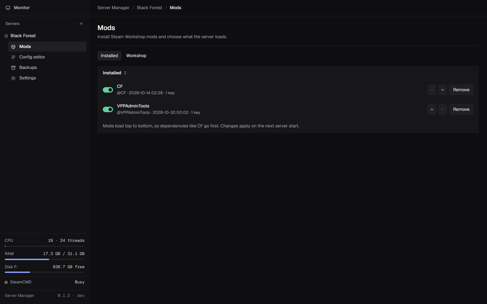

# Mods

Install Steam Workshop mods and choose what the server loads. You don't need a
Steam API key.

## Workshop

The **Workshop** tab searches DayZ's Workshop. Type in **Search by name**, and
sort by **Most popular**, **Most subscribed**, **Recently updated**, or **Best
match** when searching.

**Install** downloads the mod through SteamCMD and also installs anything it
depends on (VPPAdminTools brings Community Framework, for example). Progress
shows in a card that you **Dismiss** when it's done. Installed mods are marked
in the results.

Each mod is copied into the server folder as `@Name`, and its `.bikey` into
`keys/`, so players with the mod can join.

## Installed

The **Installed** tab is what the server loads, top to bottom. Under each name:
the folder, the date of the installed version and the number of keys.

- The **switch** loads or skips a mod without removing it.
- The **arrows** move it up or down. Frameworks (CF, Dabs Framework) go above
  the mods that use them.
- **Versions** shows the Workshop change notes.
- **Put back** returns to the version installed before the last update, if an
  update broke something. That mod is then held at that version, and auto-update
  skips it until you update it by hand.
- **Remove** deletes the mod folder and its key.
- **Update all** shows when updates are out.

[Update automatically](server) installs mod updates for you. Mod changes apply
the next time the server starts.
