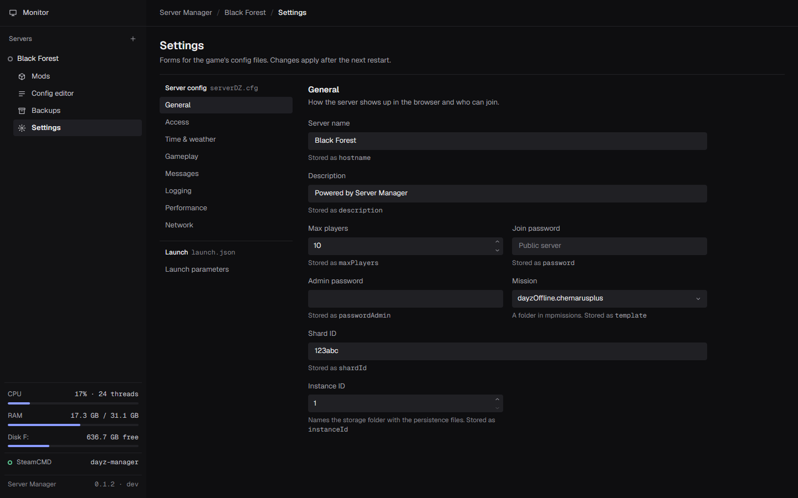

# Settings

Every server setting as a form, so you don't have to edit `serverDZ.cfg` by
hand. Each field explains itself, and fields you haven't set show DayZ's
default. Pick a group on the left, edit, and **Save**. Unsaved changes are
marked, and the page warns you before you leave with them.

A running server keeps `serverDZ.cfg` locked, so changes saved while it runs
show **Applies on the next start** and are written when it stops or starts.

## Server config

These are written to `serverDZ.cfg`.

- **General**: **Server name** (what players see in the server browser),
  description, max players, join password, admin password, **Mission** (the map:
  Chernarus, Livonia, Sakhal or a modded one), shard ID and instance ID.
- **Access**: signature checks, login queue, **Force same build**, whitelist,
  ban list, priority list, file patching and speedhack detection. The lists
  themselves are edited in the [Config editor](config-editor).
- **Time & weather**: start time, day and night speed, night lighting, and
  whether time carries over a restart.
- **Gameplay**: third person, crosshair, respawn time and dialog, voice chat and
  its quality, personal light, base and container damage, the debug monitor, and
  `cfggameplay.json`.
- **Messages**: messages of the day, one per line, and how often they cycle.
- **Logging**: log file, timestamps, FPS, memory and player-count intervals, and
  what the admin log records.
- **Performance**: view distances, loot history, ping and FPS warnings, storage
  auto fix, house state, multithreaded replication.
- **Network**: Steam query port, network ranges and batch limits. Leave these
  alone unless you know you need them.

## Launch parameters

How the server is started, stored in `launch.json`:

- **Port**: the game port (players connect to it; the next few ports are used
  too).
- **CPU cores** and **FPS limit** (0 means no limit).
- **BattlEye path** and **Storage folder**, if you keep them somewhere else.
- **Full RPT log**, **Admin log**, **Network log**, **Freeze check**, **File
  patching**.
- **Show server window** shows the server's console window instead of hiding it
  (Manager only).

Anything the form doesn't cover can be edited in the
[Config editor](config-editor).
