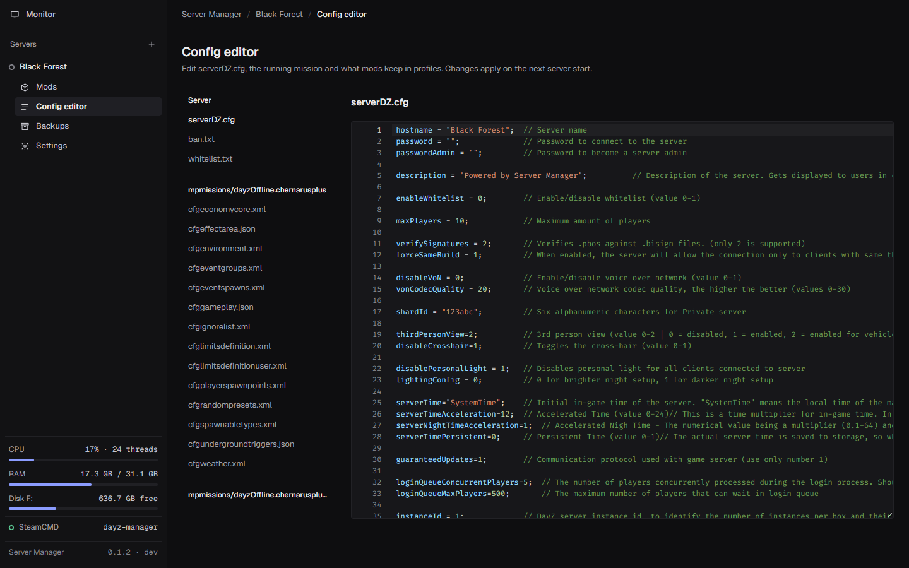

# Config editor

A text editor for the server's config files, all in one place.

It lists:

- `serverDZ.cfg`, `ban.txt`, `whitelist.txt` and `priority.txt` (one Steam ID
  per line for the last three)
- the files of the **running mission** (`mpmissions/<mission>/`):
  `db/types.xml`, `db/globals.xml`, `db/events.xml`, `cfgeconomycore.xml`,
  `cfggameplay.json` and so on
- what mods keep in `profiles/`: their settings and JSON files

Only text files (`.json`, `.xml`, `.cfg`, `.txt`, `.ini`, `.yml`, `.csv` and
`.c`) up to 2 MB are listed. Some folders are left out on purpose: Sentinel's,
`Users`, `DataCache` and the world storage (`storage_*`).

Pick a file on the left, edit it with syntax highlighting, and press **Save**
(or `Ctrl+S`). Unsaved files are marked, and you can switch between files
without losing edits.

Changes apply the next time the server starts. `serverDZ.cfg` is locked while
the server runs, so its changes wait (**Saved for the next restart**) and are
written when it stops or starts.

The list is empty until the server is installed.
