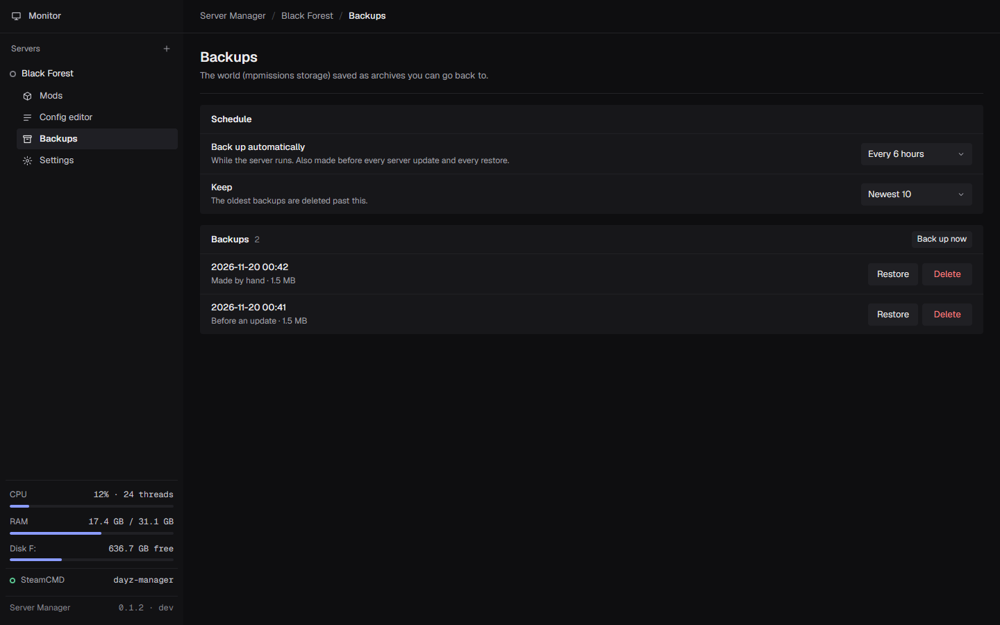

# Backups

A backup is the **world**: the mission's `storage_*` folder, which holds
players, bases, vehicles and loot. Each one is a `.tar.gz` archive you can go
back to.

## Automatic backups

- **Back up automatically**: every hour, or every few hours (up to a week),
  while the server runs.
- **Keep**: how many to keep, from 1 to 100. The oldest are deleted past that.
  Lowering it asks first, and the extra ones go at the next backup.

Backups are also made by themselves **before every server update** and **before
every restore**, so neither can lose a world. Each row says how it was made: on
a schedule, **Made by hand**, **Before an update** or **Before a restore**.

**Back up now** makes one right away, even while the server runs.

## Restore

**Restore** puts the world back as it was in that backup. The server must be
stopped (**Stop the server to restore**). The current world is backed up first,
then replaced, so a wrong restore can be undone.

**Delete** removes a backup, after a confirm.

Backups live in the server folder, under `backups/`.
