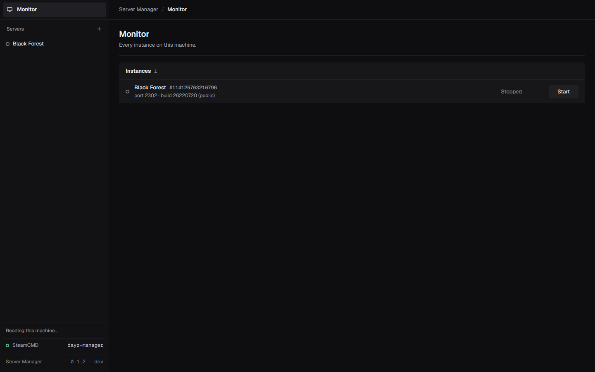

# Monitor

**Monitor**, at the top of the sidebar, is the whole machine at a glance.

- Totals: **Instances**, **Running** and **Players online**.
- Every server with its state, process ID, RAM and players. Click one to open
  it.

The bottom of the sidebar always shows:

- this machine's **CPU** (and thread count), **RAM** and free **disk** space on
  the drive the servers are on;
- **SteamCMD**: the signed-in account, **Busy** while it's downloading, or
  what's missing (Not installed, Setup unfinished, Not signed in);
- the Manager's version, and **Update to …** when a new one is out.

Clicking SteamCMD or the version opens [Manager settings](manager-settings).
