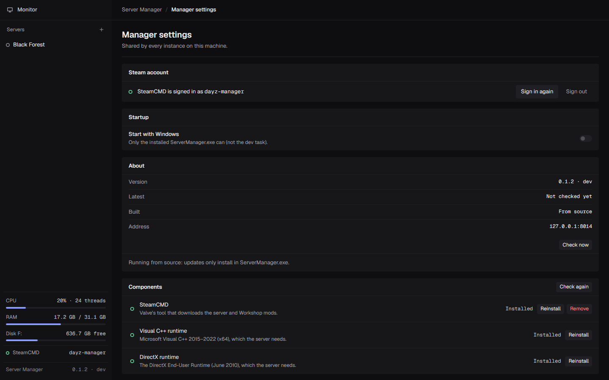

# Manager settings

Settings shared by every server on this machine. Open them from the SteamCMD
status or the version at the bottom of the sidebar.

## Steam account

The account SteamCMD signs in with, which needs to own DayZ. Enter the account
name and password, then the Steam Guard code if Steam asks for one (or confirm
on the Steam app). SteamCMD remembers the sign-in.

## Components

The same checks as first-run setup, each with its state and an install button:

- **SteamCMD**: downloads servers and mods.
- **Visual C++ runtime** and **DirectX runtime**: the DayZ server needs both.
  Windows may ask for permission to install them.

**Remove SteamCMD** moves it, with its saved sign-in, to `data/trash/`. Server
and mod downloads stop until it's installed again.

## Start with Windows

The Manager opens in the tray when you sign in to Windows, so restarts, updates
and backups keep going after a reboot. Servers that were running start again if
their **Restart on crash or hang** is on. Only the installed `ServerManager.exe`
can do this.

## About

**Version**, **Latest**, **Built** and **Address** (`http://localhost:<port>`).

The Manager checks for its own updates every 15 minutes, or now with **Check
now**. When one is out, a notice appears and the sidebar shows **Update to …**.
Updating downloads the new exe, checks its SHA-256, swaps it in and restarts the
Manager. Your game servers keep running through it.

## The port

The first time, the Manager takes the port Windows offers and remembers it
(`data/port.json`). If that port is taken later, it picks another and tells you,
and points Sentinel to it. Servers already running reconnect after their next
restart.

## Files

Everything sits next to the exe:

| Path                    | What                                              |
| ----------------------- | ------------------------------------------------- |
| `data/manager.db`       | servers, settings, charts                         |
| `data/config.json`      | SteamCMD path and account name                    |
| `data/logs/`            | the Manager's logs, a file a day, the last 7 kept |
| `data/trash/`           | deleted servers and removed SteamCMD              |
| `data/browser/`         | the app window's browser profile                  |
| `tools/steamcmd/`       | SteamCMD                                          |
| `instances/instance<N>` | the servers                                       |

To move the Manager to another machine, copy the whole folder.
